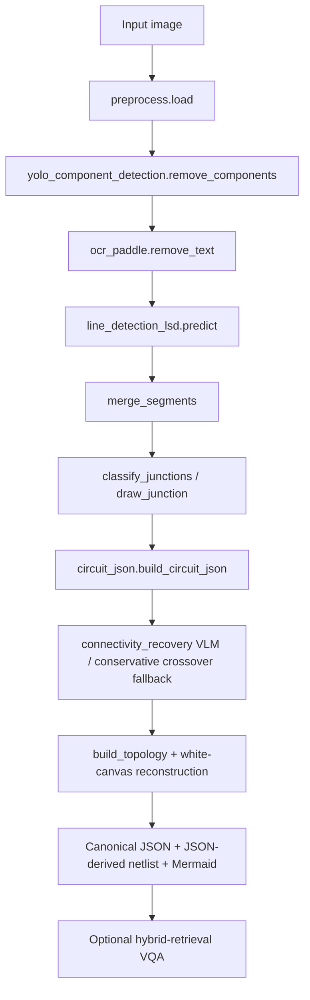

# Diagram Intelligence Pipeline

This document reflects the pipeline that is actually implemented in this repository today. The source of truth is the orchestration in `main.py`, plus the image and text modules under `src/image`.

## Pipeline at a glance



The real execution order in `main.py` is:

1. Load the source image.
2. Run YOLO component detection and remove detected non-terminal components from the image.
3. Run PaddleOCR text extraction and remove OCR text from the image.
4. Detect line segments on the cleaned image.
5. Merge nearby fragments into longer candidate wires.
6. Cluster detected endpoints/intersections into junctions.
7. Create canonical JSON containing components, wires, terminals, OCR labels, ports, and reviewable `+` crossings.
8. Use a confidence-gated VLM review for `+` crossings; unclear, failed, missing, or low-confidence decisions become conservative crossover assumptions, so no unsupported wire merge is introduced.
9. Build electrical nets, render the JSON-only white-canvas reconstruction, and emit a netlist plus Mermaid derived solely from the corrected canonical JSON.
10. When the user supplies a question, retrieve only from the local `knowledge_base/` folder and send the retrieved context, graph, and original image to the VLM.

This order differs from the earlier design doc: the current code runs component removal before OCR cleanup, and the junction logic lives in `src/image/junction_detection.py` instead of a single `line_detection.py` entry point.

## Repository locations

| Stage | Location | Main API |
|---|---|---|
| Image loading | `src/image/preprocess.py` | `load`, `read_grayscale` |
| YOLO component detection | `src/image/component_detection.py` | `yolo_component_detection.predict`, `draw_yolo`, `remove_components` |
| OCR text cleanup | `src/image/text_extraction.py` | `ocr_paddle.predict`, `ocr_paddle.remove_text` |
| Line detection | `src/image/line_detection.py` | `line_detection_lsd.predict`, `draw_lines`, `merge_segments` |
| Junction classification | `src/image/junction_detection.py` | `classify_junctions`, `segment_intersection`, `cluster_points`, `draw_junction` |
| Canonical JSON / topology / renderer | `src/text/circuit_json.py` | `build_circuit_json`, `build_topology`, `topology_to_netlist`, `topology_to_mermaid`, `render_reconstructed_circuit` |
| Crossover recovery | `src/image/connectivity_recovery.py` | `build_review_candidates`, `review_candidates_with_vlm`, `apply_review_decisions` |
| Hybrid local retrieval | `src/retrieval/knowledge_base.py` | `build_or_load_index`, `HybridRetriever` |
| Multimodal VQA | `src/retrieval/vqa.py` | `answer_circuit_question` |
| Offline evaluation only | `src/evaluation/reconstruction_evaluation.py` | `evaluate_reconstruction`, `summarise_evaluation` |
| Orchestration entry point | `main.py` | `main` script |

## Stage 1: load the image

### `preprocess.load(path)`

Definition: `src/image/preprocess.py`

Purpose:
- Validate the file path.
- Call `cv2.imread(path)`.
- Return an empty `(0, 0)` uint8 array if the file cannot be read.

Current behavior:
- `read_grayscale()` does not actually request grayscale; it calls `cv2.imread(path)` with the default BGR behavior.
- There is no resize, thresholding, denoising, or normalization in the current implementation.
- The commented-out threshold block shows where additional preprocessing could be added later.

Example:

```python
from image import preprocess

image = preprocess.load("test/full-adder-circuit.png")
if image.size == 0:
    raise FileNotFoundError("Could not load image")
```

## Stage 2: component detection and removal

### `yolo_component_detection`

Definition: `src/image/component_detection.py`

What it does:
- Loads a YOLO model from a checkpoint path in `__init__`.
- Runs inference with `self.model(img)` in `predict()`.
- Draws bounding boxes in `draw_yolo()`.
- Removes detected regions in `remove_components()`.

The current implementation preserves only these classes as wiring-related:
- `crossover`
- `terminal`
- `terminals`

Everything else is replaced with the median background color of the image. The removed crop is saved under `output/components temp/` for inspection, with filenames like `0000_resistor.png`.

Example:

```python
from image import component_detection

model = component_detection.yolo_component_detection("best.pt")
image, result = model.remove_components(image)
```

Important note:
- `remove_components()` mutates the input image in place.
- If you need the original cleaned image later, pass `image.copy()`.

## Stage 3: OCR text removal

### `ocr_paddle`

Definition: `src/image/text_extraction.py`

What it does:
- Initializes PaddleOCR in `__init__`.
- Runs `self.ocr.predict(img)` in `predict()`.
- Saves the OCR JSON result to `output` when available.
- Filters out recognized text containing `ww`, because the current project treats those as likely resistor artifacts.
- Builds a mask from every OCR box and inpaints the region with `cv2.inpaint(..., cv2.INPAINT_TELEA)` in `remove_text()`.

The OCR output is returned as a dictionary with a `res` object. The important fields are:
- `data["res"]["rec_boxes"]`
- `data["res"]["rec_texts"]`

Example:

```python
from image.text_extraction import ocr_paddle

ocr = ocr_paddle()
image, ocr_data = ocr.remove_text(image)
```

The Tesseract functions (`text_extract`, `draw_ocr`, `remove_text`) are present as alternate/legacy utilities, but the active pipeline uses the PaddleOCR class path.

## Stage 4: line detection

### `line_detection_lsd`

Definition: `src/image/line_detection.py`

This is the active detector implementation used by `main.py`.

Key methods:
- `predict(img)`: detects raw line segments.
- `draw_lines(img, lines=None)`: renders detected segments for debugging.

Behavior:
- Converts BGR images to grayscale if needed.
- Thresholds the image with Otsu.
- Inverts if the background is white and the foreground is dark.
- Skeletonizes the binary result.
- Calls `cv2.createLineSegmentDetector(cv2.LSD_REFINE_STD)`.
- Returns a NumPy array shaped `(N, 4)` where each row is `[x0, y0, x1, y1]`.

### `merge_segments`

Definition: `src/image/line_detection.py`

Purpose:
- Merge nearby fragments that belong to the same physical wire.
- Compare angle, midpoint offset, and gap tolerance.
- Rebuild a longer segment spanning the combined projection range.

Current criteria:
- Direction difference within 5 degrees.
- Perpendicular midpoint offset within 7 pixels.
- Projected gap within 14 pixels.

This function is the actual merge pass used before junction classification.

Example:

```python
from image import line_detection

line_detector = line_detection.line_detection_lsd()
raw_lines = line_detector.predict(image)
merged_lines = line_detection.merge_segments(raw_lines)
```

## Stage 5: junction detection

### `classify_junctions`

Definition: `src/image/junction_detection.py`

Purpose:
- Treat segment endpoints and pairwise intersections as candidate node positions.
- Cluster nearby points within a radius.
- Measure rays from each node to nearby segment ends/interior points.
- Group nearly collinear rays.
- Classify the node as `L`, `T`, or `+`.

The function returns a Pandas DataFrame with columns:
- `x`
- `y`
- `type`
- `degree`
- `segment_indices`

Example:

```python
from image.junction_detection import classify_junctions

junctions = classify_junctions(merged_lines)
```

### `draw_junction`

Definition: `src/image/junction_detection.py`

Purpose:
- Draw junction markers on the image.
- Use blue for `L`, orange for `T`, and green for `+`.
- Annotate the type next to each node.

This is the visualization pass used by `main.py` to generate `output/junctions.png`.

## Stage 6: canonical circuit JSON and topology

`src/text/circuit_json.py` converts detector, OCR, wire, and junction outputs into a portable JSON document. It contains component boxes, wire geometry, terminal attachments, OCR records, inferred external ports, endpoint connections, and incidence matrices.

Important connectivity rule:

- `L` and `T` junctions are initially confirmed geometric connections.
- A `+` is recorded as `intersection_or_crossover` and is **not** made an electrical connection until review confirms it.

`build_topology()` unions wires only through `confirmed_connected` junctions. Both a confirmed crossover and an uncertain `assumed_crossover` stay electrically separate. `topology_to_netlist()` and `topology_to_mermaid()` consume this corrected topology; there is no pre-JSON netlist path in `main.py`. `render_reconstructed_circuit()` draws the JSON geometry on a white canvas with grey wires, magenta component boxes, terminal markers, ports, and colour-coded junction status.

Artifacts under `output/connectivity/`:

- `canonical_circuit_before_review.json`
- `candidate_connectivity_records.json`
- `canonical_circuit.json`
- `circuit_topology.json`
- `canonical_netlist.json`
- `canonical_netlist.txt`
- `canonical_topology.mmd`
- `mermaid_topology.png`
- `reconstructed_circuit.png`

## Stage 7: connectivity recovery

`src/image/connectivity_recovery.py` creates a full-context and native-crop review board for every ambiguous `+`. It asks the configured Llama 3.2 Vision Instruct endpoint for strict JSON containing the junction ID, decision, confidence, and visual evidence.

- A filled central dot can produce `connected_intersection`.
- A plain crossing or bridge can produce `crossover`.
- Only a decision at confidence `>= 0.80` changes topology.
- Missing credentials, malformed output, timeouts, and lower-confidence output become an auditable `assumed_crossover`; this conservative choice never invents a connection.

The endpoint defaults to NVIDIA's OpenAI-compatible URL and uses `NVIDIA_API_KEY` (or `NVAPI_KEY`), `NVIDIA_INVOKE_URL`, and `NVIDIA_VLM_MODEL` when configured.

## Stage 8: local knowledge retrieval and VQA

Place PDFs, manuals, JSON/Markdown symbol libraries, and rule documents only under `knowledge_base/`. `src/retrieval/knowledge_base.py` recursively indexes this folder, extracting PDF, DOCX, JSON, Markdown, text, CSV, and YAML content. It fuses BM25 keyword scores with deterministic TF-IDF cosine-vector scores.

For `--question`, `src/retrieval/vqa.py` supplies the VLM with:

1. The user question.
2. The original circuit image.
3. Canonical topology Mermaid and JSON summary.
4. The top hybrid-retrieved knowledge chunks with source filenames.

It returns general text and saves an auditable `output/vqa_response.json`. If the remote VLM times out or is unavailable, it instead saves `output/vqa_error.json` and preserves every completed circuit-recovery artifact. No web corpus or files outside the selected local knowledge-base folder are indexed.

`src/evaluation/` is intentionally not called by `main.py`; it is reserved for offline research evaluation.

## End-to-end execution in this repo

The actual orchestration is the `main.py` entry point:

```python
from image import component_detection, line_detection, preprocess, text_extraction
from image.junction_detection import draw_junction
from text.circuit_json import build_circuit_json, build_topology, topology_to_mermaid, topology_to_netlist

image = preprocess.load(str(input_path))
if image is None or image.size == 0:
    raise FileNotFoundError(f"Could not load image: {input_path}")

yolo = component_detection.yolo_component_detection("best.pt")
image, components = yolo.remove_components(image)

paddle_ocr = text_extraction.ocr_paddle()
image, texts = paddle_ocr.remove_text(image)

line_detector = line_detection.line_detection_lsd()
raw_lines = line_detector.predict(image)
merged_lines = line_detection.merge_segments(raw_lines)

junction_image, junctions = draw_junction(image.copy(), merged_lines)

circuit = build_circuit_json(input_path, source_image, components, merged_lines, junctions, texts)
topology = build_topology(circuit)
netlist = topology_to_netlist(circuit, topology)
mermaid = topology_to_mermaid(circuit, topology)
```

The current `main.py` additionally reuses the detector result for component drawing/removal, writes canonical JSON, runs the confidence-gated crossing-review stage, builds topology, and renders `reconstructed_circuit.png`. The complete source is the authoritative reference for CLI options and progress messages.

## Output artifacts

When `main.py` runs, it writes images and CSVs into `output/`:

- `components_bounding_boxes.png`
- `components_removed.png`
- `text_removed.png`
- `lines_raw.png`
- `lines_merged.png`
- `junctions.png`
- `lines_raw.csv`
- `lines_merged.csv`
- `junctions.csv`
- `connectivity/canonical_circuit.json`
- `connectivity/circuit_topology.json`
- `connectivity/canonical_netlist.json`
- `connectivity/canonical_netlist.txt`
- `connectivity/canonical_topology.mmd`
- `connectivity/reconstructed_circuit.png`

The project also creates a temporary component crop directory at `output/components temp/` during YOLO removal.

## CLI usage

The current repository does not expose a `python -m image.line_detection` CLI in the final code path. The main entry point is the project script:

```powershell
python main.py "test/full-adder-circuit.png"
```

If no argument is provided, `main.py` defaults to `test/full-adder-circuit.png`.

To run only local deterministic stages and conservatively resolve all ambiguous `+` crossings as crossovers:

```powershell
python main.py "test/full-adder-circuit.png" --skip-vlm-review
```

To ask a knowledge-grounded question after reconstruction:

```powershell
python main.py "test/full-adder-circuit.png" --question "What does this circuit do?"
```

The second command reads only from `knowledge_base/`. Use `--rebuild-knowledge-index` after adding or changing its files.

## Summary

The current pipeline is a pragmatic, code-first workflow that matches the implementation in this repository:

- `preprocess.load()` reads the image.
- `yolo_component_detection.remove_components()` strips non-terminal components.
- `ocr_paddle.remove_text()` removes OCR text.
- `line_detection_lsd.predict()` extracts raw wire segments.
- `merge_segments()` merges fragmented wires.
- `classify_junctions()` identifies wiring intersections.
- `circuit_json.build_circuit_json()` preserves the structured representation.
- `connectivity_recovery` accepts only confidence-qualified electrical intersections and conservatively treats all other `+` cases as crossovers.
- `build_topology()`, `topology_to_netlist()`, `topology_to_mermaid()`, and `render_reconstructed_circuit()` produce the graph outputs and white-canvas reconstruction from corrected canonical JSON.
- Optional VQA combines the original image, recovered graph, and hybrid retrieval over local knowledge-base materials.

The earlier document describing a separate `run_line_detection` API and a unified `line_detection.detect_lines` wrapper is not consistent with the actual code in this branch.
